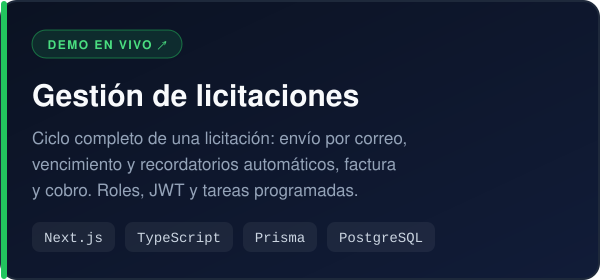
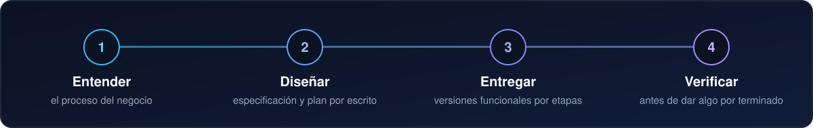

 

Construyo software a la medida para pequeñas y medianas empresas en Panamá: **ventas, facturación electrónica, inventario, reservas y reportes**. Cada proyecto empieza como una demo funcional de punta a punta, con interfaz, lógica y datos, para que el cliente pruebe la solución antes de decidir.

 

## Proyectos destacados

  
  

  
  

Las demos usan marcas, personas y datos ficticios. Código de Gestión de licitaciones: <a href="https://github.com/dany2509D/-licitaciones-app-">dany2509D/-licitaciones-app-</a>.

 

## Otros trabajos

| Proyecto | Qué resuelve |
|:--|:--|
| **Citas por WhatsApp** | Un asistente agenda, confirma y recuerda citas; la clínica lo ve todo en un panel. Probado en fisioterapia, odontología y veterinaria. |
| **Gestión para gimnasios** | Landing y panel de administración: membresías, pagos y operación diaria. |
| **Pedidos para restaurantes y foodtrucks** | Menú, pedidos y reportes para el dueño. |
| **Tiendas en línea** | Propuestas de diseño para marcas de moda y barbería, con catálogo, carrito y pago. |
| **Sitio corporativo** | Next.js con un asistente "Cuéntanos tu proyecto" y lista de espera. |

Proyectos hechos como propuestas para clientes; el código está en repositorios privados.

 

## Stack

Integraciones: WooCommerce · WhatsApp · correo transaccional · APIs REST

 

## Cómo trabajo

 

## Contacto

¿Tu negocio todavía depende de hojas de cálculo o mensajes sueltos? Hablemos: abre un [issue en este repositorio](https://github.com/dany2509D/dany2509D/issues/new) y te respondo.
