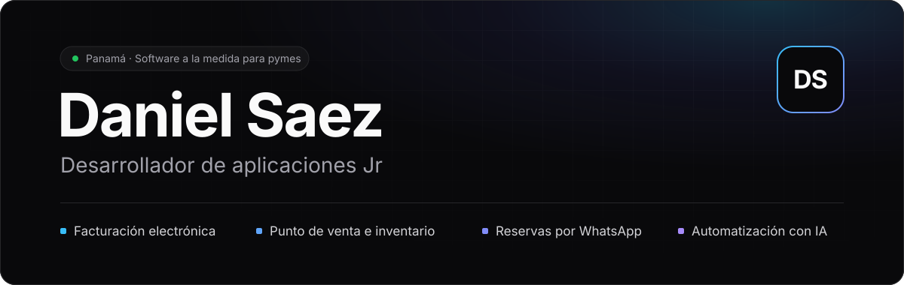
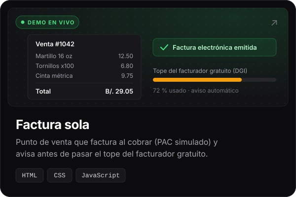
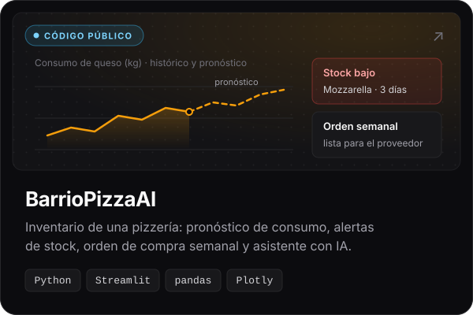

 

Desarrollo software a la medida para pequeñas y medianas empresas en Panamá: **ventas, facturación electrónica, inventario, reservas y reportes**. Construyo demos funcionales de punta a punta, con interfaz, lógica y datos, para que el cliente pruebe la solución antes de decidir.

## Proyectos destacados

  
  

  
  

Las demos usan marcas, personas y datos ficticios. El código de Gestión de licitaciones está en <a href="https://github.com/dany2509D/-licitaciones-app-">este repositorio</a>.

## Otros trabajos

Proyectos hechos como propuestas para clientes, en repositorios privados.

| Proyecto | Qué hace |
|---|---|
| **Citas por WhatsApp** | Un asistente agenda, confirma y recuerda citas; la clínica lo ve todo en un panel. Probado en fisioterapia, odontología y veterinaria. |
| **Gestión para gimnasios** | Landing y panel de administración: membresías, pagos y operación diaria. |
| **Pedidos para restaurantes y foodtrucks** | Menú, pedidos y reportes para el dueño. |
| **Tiendas en línea** | Propuestas de diseño para marcas de moda y barbería, con catálogo, carrito y pago. |
| **Sitio corporativo** | Next.js con un asistente "Cuéntanos tu proyecto" y lista de espera. |

## Tecnologías

  

Integraciones: WooCommerce, WhatsApp, correo transaccional y APIs REST.

## Cómo trabajo

## Contacto

¿Tienes un proceso que todavía depende de hojas de cálculo o mensajes sueltos? Escríbeme abriendo un [issue en este repositorio](https://github.com/dany2509D/dany2509D/issues/new).
